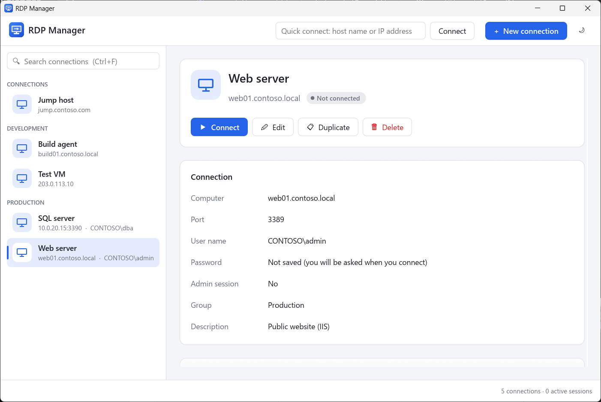
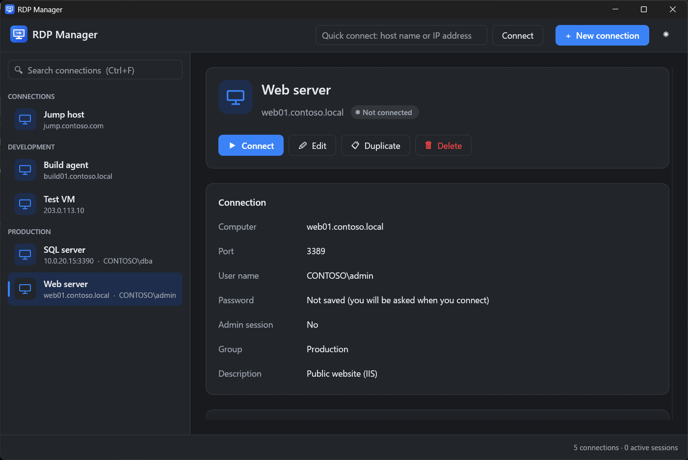

# RDP Manager

A simple, modern Remote Desktop connection manager for Windows. It keeps a list of your servers, connects with one click, and stores passwords safely in Windows Credential Manager. No accounts, no subscriptions, and no connection limits.

It is a single, small `.exe` written in Rust. Sessions open in the Remote Desktop client built into Windows (`mstsc.exe`), so they behave exactly as you expect.



## Features

- **Saved connections:** name, computer (host name or IP address), port, user name, group, and notes. Connections are grouped and searchable.
- **Quick connect:** type a host name or IP address (`host` or `host:port`) and press Enter. A quick session can be saved as a connection.
- **Connect and disconnect:** active sessions are shown in the sidebar. Disconnect closes the Remote Desktop window; you stay signed in on the server.
- **Saved passwords:** stored in Windows Credential Manager, encrypted for your Windows account. They are never written to the connections file.
- **Display options:** full screen, all monitors, or a fixed window size.
- **Local resources:** clipboard, drives, printers, and audio.
- **Light and dark themes**, and full keyboard control.



## Install

1. Download `rdp-manager.exe` from the [latest release](https://github.com/zgriffiin/rdp-manager/releases/latest).
2. Run it. No installer is needed.

The `.exe` is not code-signed, so Windows SmartScreen may show "Windows protected your PC" the first time. Select **More info**, then **Run anyway**.

Requirements: Windows 10 or 11 (64-bit).

## Keyboard shortcuts

| Key | Action |
| --- | --- |
| Ctrl+N | New connection |
| Ctrl+F | Search connections |
| ↑ / ↓ | Select a connection |
| Enter | Connect |
| F2 | Edit |
| Delete | Delete |
| Esc | Close a dialog |

Double-click a connection to connect, or right-click it for more actions.

## Where your data is stored

| What | Where |
| --- | --- |
| Connections and settings | `%APPDATA%\RdpManager\connections.json` |
| Passwords | Windows Credential Manager, as `RdpManager/<id>` |

When you connect with a saved password, RDP Manager gives it to Remote Desktop as a temporary `TERMSRV/<host>` credential. That credential is removed when the session ends. A `TERMSRV/<host>` credential that you saved yourself is never changed or removed.

If the connections file cannot be read, it is moved to `connections.broken-<time>.json` and never overwritten.

## Build from source

Requires [Rust](https://rustup.rs/) (stable, MSVC toolchain).

```powershell
cargo build --release
# Output: target\release\rdp-manager.exe
```

Run the tests with `cargo test`.

## License

[MIT](LICENSE)
